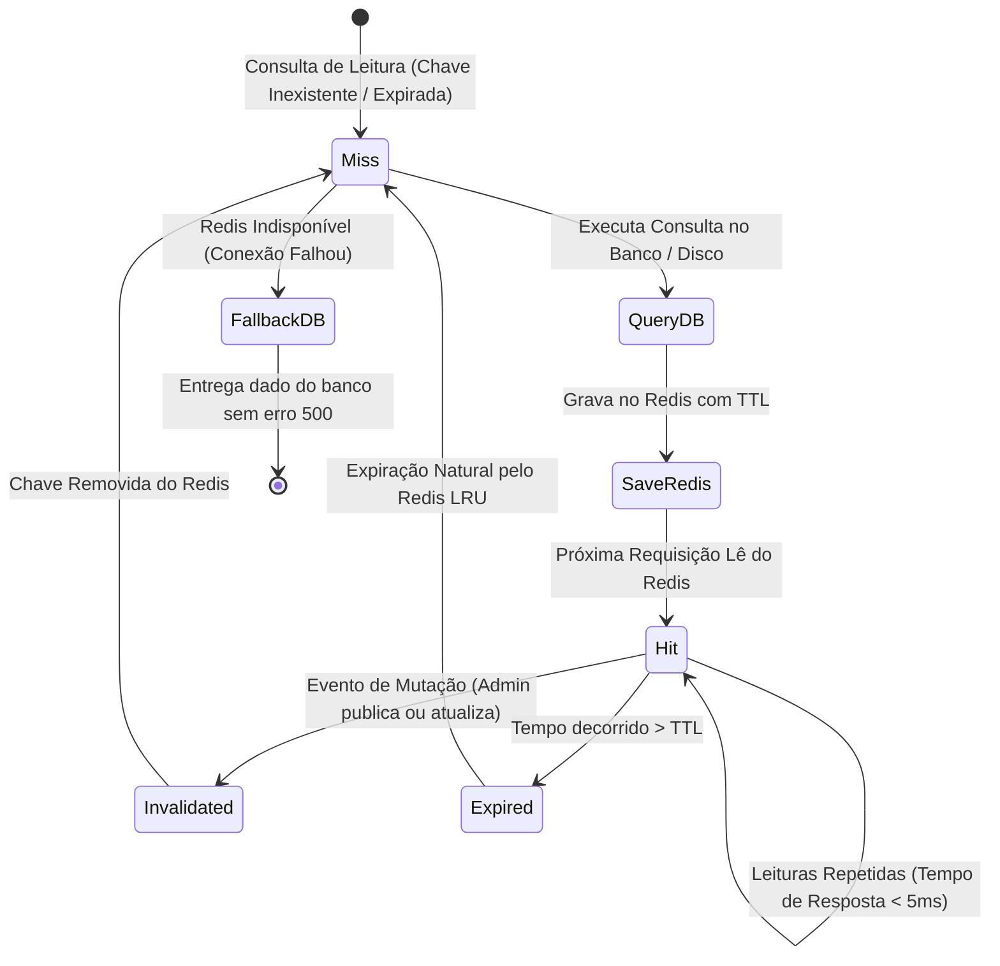

# Data Model & Storage Layout: Sistema de Cache em Redis e Referência de Storage

**Feature**: `009-cache-redis-referencia-storage`  
**Status**: Concluído  
**Data**: 2026-10-15  

---

## 1. Estrutura de Entidades de Cache (Redis)

O sistema de cache gerencia entradas temporárias em memória no Redis para acelerar leituras frequentes e aliviar consultas relacionais no PostgreSQL.

### 1.1 Esquema de Chaves e Metadados

| Chave de Cache | Tipo de Dado | TTL Padrão | Descrição do Conteúdo | Gatilho de Invalidação |
|---|---|---|---|---|
| `institutional:landing:content` | `array` (JSON) | 86400s (24h) | Estrutura completa de seções, textos e URLs da landing page publicada | Publicação de rascunho em `PublishInstitutionalPageDraft` |
| `institutional:brand:published` | `array` (JSON) | 86400s (24h) | Dados de marca (nome do clube, logo URL, tema, layouts) | Publicação de rascunho em `PublishInstitutionalPageDraft` |
| `regionals:active:list` | `array` (JSON) | 43200s (12h) | Lista de regionais ativas ordenadas por nome (`id`, `name`, `code`) | Criação, alteração ou exclusão de `Regional` |
| `regionals:{id}:with_cities` | `array` (JSON) | 43200s (12h) | Dados da regional com coleção de cidades associadas ativas | Alteração em `Regional` ou `RegionalCity` da regional |
| `user:{id}:permissions` | `array` (JSON) | 3600s (1h) | Lista compilada de permissões ativas `[['area' => string, 'action' => string]]` | Mudança em `RoleAssignment`, `ClubRole`, `AccessGroup` ou `PermissionGrant` |
| `health:test:ping` | `string` | 60s (1m) | Chave efêmera utilizada para diagnóstico de conectividade e latência | Expirada automaticamente ou excluída pelo teste de saúde |

### 1.2 Estrutura Lógica de Cache Entry

```typescript
// Representação lógica do Snapshot da Landing Page em Cache
interface CachedInstitutionalLanding {
    title: string;
    subtitle?: string;
    app_layout: 'sidebar' | 'header';
    auth_layout: 'simple' | 'card' | 'split';
    logo_path?: string;
    logo_url?: string;
    sections: Array<{
        id: string;
        type: string;
        position: number;
        enabled: boolean;
        title?: string;
        content?: string;
        image_path?: string;
        image_url?: string;
        metadata?: Record<string, unknown>;
    }>;
    cached_at: string; // ISO 8601
}

// Representação lógica de Marca Institucional em Cache
interface CachedInstitutionalBrand {
    club_name: string;
    logo: string | null;
    favicon: string | null;
    primary_color?: string;
    app_layout: string;
    auth_layout: string;
    cached_at: string; // ISO 8601
}

// Representação lógica das Regionais Ativas em Cache
interface CachedRegionalItem {
    id: number;
    name: string;
    code: string;
    city?: string;
    state?: string;
}

// Representação lógica de Permissões Compiladas em Cache
interface CachedUserPermissions {
    user_id: number;
    permissions: Array<{
        area: string;
        action: string;
    }>;
    cached_at: string; // ISO 8601
}
```

---

## 2. Ciclo de Vida e Transições de Estado de Cache



---

## 3. Estrutura de Armazenamento Físico e Mapeamento Docker

### 3.1 Diretório de Referência de Storage no Host

A pasta de referência oficial de persistência local no projeto é padronizada na pasta raiz `./data/storage` (com dados do Redis em `./data/redis`), estruturada da seguinte forma:

```text
mc_ctrlr/
├── data/
│   ├── .gitignore                  <-- Ignora todo conteúdo persistido, mantendo apenas arquivos de estrutura
│   ├── redis/                      <-- Persistência em disco do Redis (RDB / AOF)
│   │   └── .gitkeep
│   └── storage/                    <-- Ponto de Referência Unificado de Armazenamento no Host
│       ├── .gitignore
│       ├── public/                 <-- Arquivos públicos (Mídias, Logos, Avatares, Feed)
│       │   ├── .gitignore
│       │   ├── avatars/
│       │   ├── brand/
│       │   ├── feed/
│       │   └── landing/
│       ├── receipts/               <-- Arquivos privados (Comprovantes de pagamento)
│       │   └── .gitignore
│       └── private/                <-- Arquivos temporários e rascunhos internos
│           └── .gitignore
```

### 3.2 Mapeamento de Volumes no Docker

| Caminho no Host | Caminho no Contêiner | Serviço Docker | Modo de Acesso | Finalidade |
|---|---|---|---|---|
| `./data/storage` | `/var/www/html/storage/app` | `app` | Leitura e Escrita (`rw`) | Persistência unificada de uploads e comprovantes |
| `./data/storage/public` | `/var/www/html/storage/app/public` | `nginx` | Somente Leitura (`ro`) | Entrega estática ultra-rápida de `/storage/*` |
| `public_path('storage')` | `storage_path('app/public')` | `app` | Symlink simbólico | Compatibilidade nativa com Laravel `Storage::url()` |
| `./data/redis` | `/data` | `redis` | Leitura e Escrita (`rw`) | Persistência híbrida em disco (RDB/AOF) do Redis |

### 3.3 Regras de Permissão e Proteção Git

1. **Permissões de Sistema Operacional (Linux/Docker)**:
   - Diretórios `data/storage/public` e `data/storage/receipts`: permissão `0775`.
   - Propriedade: usuário da aplicação dentro do contêiner (`www-data` ou UID corrente).
2. **Arquivos `.gitignore` de Proteção**:
   - `data/.gitignore`:
     ```gitignore
     *
     !.gitignore
     !*/
     !*/**/.gitkeep
     !*/**/.gitignore
     ```
   - Garante que a estrutura de pastas exista no repositório Git, mas arquivos reais enviados por uploads e dumps do Redis permaneçam estritamente no host local e nunca vazem para o repositório.

