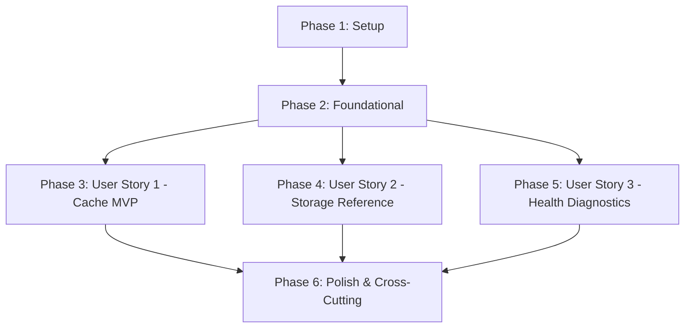

# Tasks: Sistema de Cache em Redis e Referência Unificada de Storage no Docker

**Feature**: `009-cache-redis-referencia-storage`  
**Input**: [spec.md](./spec.md), [plan.md](./plan.md), [data-model.md](./data-model.md), [contracts/](./contracts/), [quickstart.md](./quickstart.md)  
**Status**: Completed  

---

## Phase 1: Setup (Shared Infrastructure)

**Purpose**: Configuração de serviços de infraestrutura, dependências PHP/Docker e variáveis de ambiente compartilhadas.

- [x] T001 Configure Docker compose services and volume mappings for Redis, App, and Nginx in `compose.yaml`
- [x] T002 Add PECL Redis C-extension installation and configuration in `Dockerfile`
- [x] T003 [P] Add `predis/predis` package dependency for fallback compatibility in `composer.json`
- [x] T004 [P] Update environment variables (`CACHE_STORE=failover`, `REDIS_HOST=redis`, `REDIS_PORT=6379`, `REDIS_CLIENT=phpredis`) in `.env.example` and `.env`

---

## Phase 2: Foundational (Blocking Prerequisites)

**Purpose**: Estrutura física de diretórios no host, drivers de resiliência e contrato base de cache que bloqueiam todas as User Stories.

**⚠️ CRITICAL**: Nenhuma User Story pode ser iniciada antes da conclusão desta fase.

- [x] T005 Initialize persistent host data directory structure (`data/storage/public`, `data/storage/receipts`, `data/storage/private`, `data/redis`) and gitignore rules in `data/.gitignore`
- [x] T006 [P] Configure cache stores (`failover` and `redis`) with fallback order `['redis', 'database', 'array']` in `config/cache.php`
- [x] T007 [P] Configure Redis database connections, max retries, and cluster options in `config/database.php`
- [x] T008 Create cache manager interface `AppCacheManagerInterface` per contract in `app/Services/Cache/AppCacheManagerInterface.php`
- [x] T009 Implement base `AppCacheManager` service with graceful fallback on connection failure in `app/Services/Cache/AppCacheManager.php`

**Checkpoint**: Fundação pronta - implementação das User Stories pode prosseguir.

---

## Phase 3: User Story 1 - Aceleração de Conteúdo e Cache com Invalidação Automática (Priority: P1) 🎯 MVP

**Goal**: Visitantes e membros desfrutam de carregamento quase instantâneo na landing page institucional, regionais ativas e permissões, com invalidação atômica imediata em mutações e fallback gracioso sem erro 500 se o Redis estiver inativo.

**Independent Test**: Requisições repetidas de leitura reduzem tempo de resposta em mais de 50%; publicação de alterações invalida chaves imediatamente (< 500ms); pausar o contêiner do Redis mantém a aplicação respondendo `HTTP 200 OK` transparente.

### Tests for User Story 1

> **NOTE: Write these tests FIRST, ensure they FAIL before implementation**

- [x] T010 [P] [US1] Create automated feature tests for Redis cache hit/miss, immediate invalidation, and failover fallback in `tests/Feature/RedisCacheTest.php`

### Implementation for User Story 1

- [x] T011 [US1] Implement landing page and brand caching (`institutional:landing:content`, `institutional:brand:published`) and invalidation in `app/Services/Cache/AppCacheManager.php`
- [x] T012 [US1] Connect `PublishInstitutionalPageDraft` action to trigger landing and brand cache invalidation in `app/Actions/PublishInstitutionalPageDraft.php`
- [x] T013 [US1] Update `InstitutionalLandingController` to retrieve published landing page content via `AppCacheManager` in `app/Http/Controllers/InstitutionalLandingController.php`
- [x] T014 [US1] Update `InstitutionalBrand` helper to retrieve published brand and layout via `AppCacheManager` in `app/Support/InstitutionalBrand.php`
- [x] T015 [US1] Implement active regionals caching (`regionals:active:list`, `regionals:{id}:cities`) and invalidation in `app/Services/Cache/AppCacheManager.php`
- [x] T016 [US1] Connect `RegionalController` mutations (store, update, destroy) and city updates to invalidate regional cache in `app/Http/Controllers/RegionalController.php`
- [x] T017 [US1] Implement compiled user permissions caching (`user:{id}:permissions`) with global (`user:*:permissions`) and granular invalidation in `app/Services/Cache/AppCacheManager.php`
- [x] T018 [US1] Connect role and permission mutations (`RoleAssignmentController`, `ClubRoleController`, `AccessGroupController`) to invalidate permissions cache in `app/Http/Controllers/RoleAssignmentController.php`, `app/Http/Controllers/ClubRoleController.php`, and `app/Http/Controllers/AccessGroupController.php`
- [x] T019 [US1] Update `HandleInertiaRequests` middleware to consume cached active regionals and cached user permissions in `app/Http/Middleware/HandleInertiaRequests.php`

**Checkpoint**: User Story 1 totalmente funcional e testável de forma independente (MVP concluído).

---

## Phase 4: User Story 2 - Referência de Armazenamento Persistente e Unificado no Docker (Priority: P2)

**Goal**: Garantir que todos os arquivos enviados (mídias públicas e comprovantes privados) possuam referência física consistente na pasta raiz `./data/storage` fora da árvore de código, preservando 100% dos arquivos após parada e recriação de contêineres e com entrega estática via Nginx.

**Independent Test**: Arquivo enviado por upload é gravado fisicamente em `./data/storage/public`; destruição e subida de contêineres (`docker compose down && docker compose up -d`) preserva o arquivo intacto e o Nginx entrega via `http://localhost:8080/storage/*`.

### Tests for User Story 2

- [x] T020 [P] [US2] Create automated feature tests for storage reference paths, upload persistence, and symlink validity in `tests/Feature/StorageReferenceTest.php`

### Implementation for User Story 2

- [x] T021 [US2] Configure static `/storage/` delivery block with browser caching headers in `docker/nginx/default.conf`
- [x] T022 [US2] Update startup scripts (`start.sh`, `start.ps1`, `start.bat`) to verify host directories (`./data/storage/public`, `./data/storage/receipts`, `./data/redis`) and run `php artisan storage:link --force`
- [x] T023 [US2] Document Docker host storage reference layout and permission requirements in `README.md`

**Checkpoint**: User Story 2 totalmente funcional e testável de forma independente.

---

## Phase 5: User Story 3 - Diagnóstico e Saúde Operacional de Cache e Armazenamento (Priority: P3)

**Goal**: Fornecer aos administradores e pipelines comandos de diagnóstico simples e confiáveis (`app:cache-health` e `app:storage-health`) para inspecionar latência, conectividade e integridade física de storage.

**Independent Test**: Executar `php artisan app:cache-health --json` e `php artisan app:storage-health --json` retorna código `0` com telemetria detalhada de latência (< 10ms) e permissões de disco.

### Tests for User Story 3

- [x] T024 [P] [US3] Create automated feature tests for diagnostic health commands and JSON output in `tests/Feature/InfraHealthCommandsTest.php`

### Implementation for User Story 3

- [x] T025 [US3] Implement `app:cache-health` Artisan command with ping, latency benchmark, write/read/TTL test, and fallback check in `app/Console/Commands/CacheHealthCommand.php`
- [x] T026 [US3] Implement `app:storage-health` Artisan command with directory permissions verification and symlink validation in `app/Console/Commands/StorageHealthCommand.php`

**Checkpoint**: Todas as User Stories integradas e operacionais.

---

## Phase 6: Polish & Cross-Cutting Concerns

**Purpose**: Validação de qualidade, formatação de código, análise estática e verificação do guia rápido.

- [x] T027 [P] Run code formatting with Laravel Pint (`composer lint` / `pint --parallel`)
- [x] T028 [P] Run static analysis with Larastan/PHPStan (`phpstan analyse`)
- [x] T029 Execute full test suite (`php artisan test`) and execute quickstart scenarios from `specs/009-cache-redis-referencia-storage/quickstart.md`

---

## Dependencies & Execution Order

### Phase Dependencies

- **Setup (Phase 1)**: Sem dependências - inicia imediatamente.
- **Foundational (Phase 2)**: Depende do Setup - BLOQUEIA todas as User Stories.
- **User Stories (Phase 3, 4, 5)**: Dependem da Fase Foundational.
  - Podem ser executadas em sequência (P1 → P2 → P3) ou em paralelo.
- **Polish (Phase 6)**: Depende da conclusão das User Stories desejadas.

### User Story Dependencies

- **User Story 1 (P1)**: Inicia após a Fase 2. Não possui dependência de US2 ou US3.
- **User Story 2 (P2)**: Inicia após a Fase 2. Utiliza a pasta `./data/storage` inicializada na Fase 2.
- **User Story 3 (P3)**: Inicia após a Fase 2. Inspeciona o cache (US1) e o storage (US2).

---

## Parallel Opportunities

- **Setup**: T003 e T004 podem ser executadas em paralelo com T001/T002.
- **Foundational**: T006 e T007 podem ser executadas em paralelo.
- **Testes por Story**: T010, T020 e T024 podem ser escritos em paralelo após a Fase 2.
- **User Stories**: Após a Fase 2, US1 e US2 podem ser implementadas em paralelo por diferentes desenvolvedores.
- **Polish**: T027 e T028 podem rodar em paralelo antes de T029.

---

## Implementation Strategy

### MVP First (User Story 1 Only)

1. Concluir **Fase 1: Setup** (T001 - T004).
2. Concluir **Fase 2: Foundational** (T005 - T009).
3. Concluir **Fase 3: User Story 1** (T010 - T019).
4. **Validar MVP**: Executar `RedisCacheTest` e validar aceleração de carregamento e invalidação automática na landing page.

### Entrega Incremental

1. **Incremento 1 (MVP)**: Setup + Foundational + User Story 1 (Cache em Redis com failover e invalidação automática).
2. **Incremento 2**: User Story 2 (Referência física de storage em `./data/storage` e entrega Nginx).
3. **Incremento 3**: User Story 3 (Comandos de diagnóstico `app:cache-health` e `app:storage-health`).
4. **Incremento 4**: Polish (Pint, PHPStan, suíte completa e validação quickstart).
